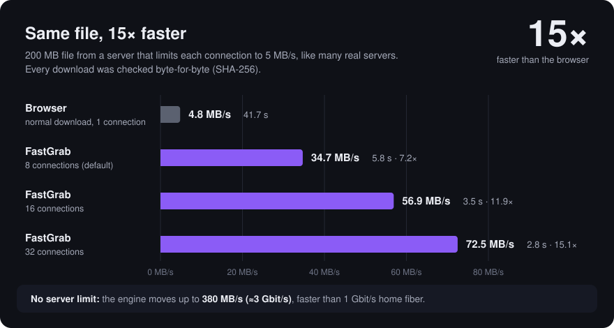
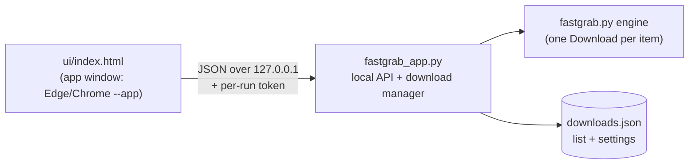
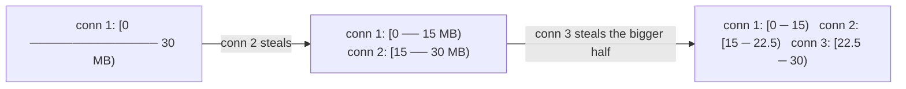

# fastgrab ⚡

[](https://github.com/mohamadar8162-design/fastgrab/actions/workflows/tests.yml)


**Up to 15× faster downloads.** A multi-connection download manager with a desktop app and a command-line tool, built with **only the Python standard library**. Optional **video mode** downloads from YouTube, TikTok, Instagram, X, Facebook, Reddit, Vimeo and 1,000+ other sites.


It speeds up downloads the same way IDM does: it splits a file into byte ranges, downloads them over several connections in parallel, and keeps every connection busy until the last byte by **stealing work** from the slowest one. If the download is interrupted (Ctrl+C, a dropped connection, even a crash or power cut), it resumes where it left off.

The **desktop app** shows every connection live in the *connections map*: each color is one connection filling its own part of the file. When one finishes, it takes over half of the slowest one's remaining bytes.

The **command-line tool** does the same in a terminal:

```
$ python fastgrab.py https://example.com/big.iso -c 8
File : big.iso
Size : 200.0 MB
Resumable: yes
[##############################] 100.0%  200.0 MB/200.0 MB  37.6 MB/s  ETA 0:00  conns 8
Done -> ./big.iso
Time : 0:05 (5.4 s), average 36.9 MB/s
```

## Benchmark



| | Connections | Time | Speed | vs. browser |
|---|---|---|---|---|
| Browser (normal download) | 1 | 41.7 s | 4.8 MB/s | 1× |
| **FastGrab** (default) | 8 | 5.8 s | 34.7 MB/s | **7.2×** |
| **FastGrab** | 16 | 3.5 s | 56.9 MB/s | **11.9×** |
| **FastGrab** | 32 | 2.8 s | 72.5 MB/s | **15.1×** |

200 MB file from a test server that limits each connection to 5 MB/s (many real servers limit each connection like this). Each row is the average of 2 runs, and every downloaded file had the same SHA-256 as the original. With no limit on the server, the engine reaches **380 MB/s (about 3 Gbit/s)**, so it won't be what slows you down. The test machine had only 2 CPU cores, running the server and FastGrab at the same time.

> How much faster you get depends on the server and your connection. If a single connection already uses all of your bandwidth, extra connections can't add more speed. Internet plans are sold in megabits: a 100 Mbit/s plan tops out around 12 MB/s, 1 Gbit/s fiber around 120 MB/s.

## Features

**Desktop app**
- Dark glass interface with a downloads list, sidebar filters (status and file type) and search
- Live **connections map** (per-connection segment bars) and a **speed graph**
- Pause, resume, retry, cancel, open file, show in folder
- Up to 3 downloads at once, with the rest queued
- Paste a link anywhere with Ctrl+V, or drag a link onto the window
- Only one window: opening FastGrab again brings up a fresh window and the old one closes itself

**Runs in the background** (system tray)
- Closing the window doesn't stop anything: FastGrab stays in the tray next to the clock, and downloads and the schedule carry on. Measured: same speed with the window open or closed (21.9 vs 21.7 MB/s, within noise)
- Click the icon to open the window; right-click for **Pause all**, **Resume all** and **Quit**
- The tooltip shows what's downloading and how fast; a Windows notification tells you when a download finishes or fails while the window is closed
- Keeps the PC awake while downloading, and opts out of Windows' background "power throttling"
- Quit mid-download and the downloads continue on the next start
- Prefer the old way? Turn off **Keep downloading when I close the window** in Settings

**Browser extension** (Chrome and Edge)
- Downloads you start in the browser go to FastGrab automatically (programs, archives, videos, music, PDFs)
- Right-click → **Download link with FastGrab** / **Download video with FastGrab**
- Your cookies travel with the download, so files behind a login work too
- If FastGrab isn't open, the browser just downloads normally, so nothing is lost
- Paired with the app by a secret key: other extensions and websites can't use it

**Scheduler**
- Download only within a time window (for example 02:00–08:00). Queued downloads wait, and running ones pause when the window ends and continue next time
- **Start now** on any download overrides the schedule
- When everything finishes: close FastGrab, sleep or shut down the PC (once, with a 60-second countdown you can cancel)

**Auto-update**
- yt-dlp updates itself daily from PyPI, verified against PyPI's SHA-256 (also inside the `.exe`, no pip needed). A broken update automatically falls back to the previous copy
- FastGrab checks GitHub for new releases and updates itself (verified against the release's `SHA256SUMS.txt`), then restarts in the same window
- A popup tells you when an update is ready, with what's new: **Update now** installs it and restarts FastGrab by itself (running downloads continue afterwards), **Later** asks again the next day. When video support has updated itself, it asks you to **Restart** to finish

**Languages:** English, العربية and עברית, with a full right-to-left layout.

**Video mode** (optional, powered by [yt-dlp](https://github.com/yt-dlp/yt-dlp))
- Paste a link from YouTube, TikTok, Instagram, X/Twitter, Facebook, Reddit, Vimeo, Twitch, SoundCloud, Pinterest and more
- A quality picker with the video's thumbnail: best, 4K, 1440p, 1080p, 720p, 480p, 360p or audio only
- Pause, resume and cancel work the same as for files
- If a link turns out to be a web page instead of a file, FastGrab automatically tries it as a video page
- One click in the app installs video support (`yt-dlp[default]` + FFmpeg). The `.exe` already includes it
- YouTube needs a JavaScript runtime ([Node.js](https://nodejs.org) 20+ or [Deno](https://deno.com)) installed, which yt-dlp requires for YouTube since late 2025

> Only download videos you have the right to save. Many sites' terms of service restrict downloading.

**Engine**

- **Parallel segmented downloads** over HTTP `Range` requests (default 8 connections)
- **Dynamic work stealing**: idle connections split the largest remaining segment, so there's no slow tail at the end
- **Crash-safe resume**: progress is checkpointed every second and survives `kill -9` and power loss
- **Change detection**: if the file changed on the server (ETag / Last-Modified / size), it restarts instead of producing a corrupted file
- **Automatic retries** with exponential backoff when connections drop
- **Fallback** to a single connection when the server doesn't support ranges
- **No merge step**: every connection writes straight to its final offset in one file
- Custom headers (`Cookie`, `Referer`, …) for downloads that need you to be logged in
- Zero dependencies, so it runs anywhere Python 3.10+ runs (Windows, macOS, Linux)

## Download (no Python needed)

From the [Releases page](https://github.com/mohamadar8162-design/fastgrab/releases/latest):

- **`FastGrab.exe`** is the desktop app. Double-click it to open the window.
- **`fastgrab-cli.exe`** is the command-line tool: `.\fastgrab-cli.exe https://example.com/big.iso -c 16`, or for a video: `.\fastgrab-cli.exe "https://youtu.be/..." -q 1080`

Both are single files with nothing to install. They're built and tested automatically by GitHub Actions from the source in this repo.

To run the app from source instead: `python fastgrab_app.py`.

## Install from source (Windows)

```powershell
powershell -ExecutionPolicy Bypass -File install.ps1
```

This copies fastgrab to `%LOCALAPPDATA%\Programs\fastgrab` and adds that folder to your **user** PATH. Your other PATH entries aren't touched, and a backup is saved first. No admin rights are needed. Then open a new terminal and run `fastgrab URL` from anywhere. To remove it, run `uninstall.ps1`, which removes only what the installer added.

On macOS/Linux, just run `python3 fastgrab.py URL`.

## Usage

```bash
python fastgrab.py URL                          # 8 connections, save to current folder
python fastgrab.py URL -c 16 -o ~/Downloads     # 16 connections, custom folder
python fastgrab.py URL -H "Cookie: session=abc" -H "Referer: https://site.com"
```

Press **Ctrl+C** to pause. Run the same command again to resume.

## How it works

### Desktop app architecture

The window is a web page shown in its own Edge/Chrome app window, talking to a small local server. That keeps FastGrab free of dependencies:



- The window is a single HTML page shown by Edge (built into Windows) in app mode, so it has no tabs or address bar.
- The page polls `/api/state` twice per second. The engine's `snapshot()` returns status, speed, ETA and every segment's `[start, pos, end, connection]`, which the page draws on a `<canvas>`.
- **Security:** the API listens only on `127.0.0.1`, requires a random 192-bit token generated at each start, and checks the `Host` header. That stops websites you visit from controlling your downloads through cross-site requests or DNS rebinding.
- When the window closes, the app pauses all downloads (saving their resume state) and exits.


### 1. Probe without a wasted request

The first request is a normal `GET` with `Range: bytes=0-`. If the server answers `206 Partial Content` with a `Content-Range` header, ranges are supported and we learn the total size. That same response then keeps streaming as connection #1, so no separate `HEAD` request is needed. A `200` means no range support, so fastgrab falls back to one connection.

### 2. Work stealing

Each segment is a byte range `[pos, end)`. When a connection is idle, it takes the segment with the most bytes left and splits it at the midpoint (4 KiB aligned, never below 512 KiB):



The victim's `end` simply shrinks. It notices on its next read, writes up to the new end, and closes its connection. The same thing happens whenever a connection finishes early, so fast connections keep helping slow ones until the very end.

To make stealing safe across threads, each segment tracks two cursors:
- `claim` is how far the owner has *reserved* (used for splitting, so a split can never land on bytes that are about to be written)
- `pos` is how far is actually *written* (used for saving state, so saved progress is never ahead of the disk)

### 3. Positioned writes

The output file `name.fgpart` is pre-allocated to its full size, and every connection writes its bytes directly at their offset (`seek` + `write`). When everything is done, the file is fsynced and atomically renamed. There are no temporary part files and no slow merge step.

### 4. Crash-safe resume

Every second, fastgrab saves the remaining segments to `name.fgpart.json`, in this order:

1. **snapshot** the segment table
2. **fsync** the data file
3. **atomically replace** the JSON (write to `.tmp`, fsync, `os.replace`)

Because the snapshot comes before the fsync, the saved state can never claim bytes that aren't really on disk. On restart, fastgrab probes the URL again, compares size + ETag + Last-Modified with the saved state, and only downloads what's missing.

## Tests

```bash
python -m unittest discover -s tests -v
```

The suite starts a local HTTP server (`tests/server.py`) that can throttle each connection, ignore `Range`, or randomly cut connections. Each test then checks the SHA-256 of the downloaded file:

| Test | What it proves |
|---|---|
| `test_multi_connection_matches_and_is_faster` | 8 connections give an identical file and finish over 3× faster than 1 |
| `test_resume_after_hard_crash` | the process is `SIGKILL`ed mid-download and resumes to an identical file |
| `test_server_without_range_support` | single-connection fallback works |
| `test_survives_dropped_connections` | a server that randomly drops connections still yields a correct file |
| `test_splits_never_overlap_or_leave_gaps` | 2000 random claim/steal steps always tile the file exactly |
| `test_features` (10) | scheduler window math, waiting / starting / pausing at the window edges, "Start now", when-done countdown + cancel + run-once, settings and languages, extension pairing key, cookies passed to a login-only file, video links opening the picker |
| `test_update` (4) | yt-dlp update from a fake PyPI: checksum verified, loaded from the addons folder ahead of the installed copy, a wrong checksum rejected, a broken build falling back; **a full self-update**: FastGrab finds v9.9.9, installs it, restarts itself and the same session keeps working |
| `extension.test.mjs` (6) | the extension's rules for which downloads to catch |
| `ui_e2e.py` (31, run locally) | the app window in a real Chrome: every sidebar filter and the search box show the right downloads, and switching back to **All downloads** always brings every row back, even when clicking faster than the animations; **the update popup** against a fake GitHub release: release notes, *Later* (also after reopening the window), Arabic layout, *Update now* installing, restarting by itself and coming back on the new version with the downloads list intact; the *Restart to finish updating* popup after video support updated itself |
| `extension_e2e.py` (13, run locally) | the real extension in Chrome: pairing via the popup, catching a click on a download link, cookies, right-click menu, video pages, falling back to the browser when FastGrab is closed, Arabic/Hebrew popup |
| `test_app` video tests (3) | video info lookup, quality choice, pause/resume of a video, automatic web-page → video fallback, cancel removes temp files (uses yt-dlp's generic extractor on a local page) |
| `test_tray` (13) | closing the window: keeps downloading and stays in the tray (or, without a tray, quits once the queue is done), the old quit-on-close setting (and the download continuing on the next start), one window at a time, starting FastGrab again shows the running copy, Pause all / Resume all; on Windows the real tray icon driven by Windows messages (click, menu commands, notification, Explorer restart), keep-awake and Quit from the tray |
| `test_app` (5 tests) | app API: live segments, pause/resume, unique names for same-name downloads, cancel deletes only its own partial files, rejects non-http links, 403 without token or with a foreign `Host` |

The release pipeline runs `test_app` against the built **`FastGrab.exe`** itself before publishing it.

Tests run on Linux, Windows and macOS through GitHub Actions.

## Roadmap

- [x] Browser extension (Chrome/Edge)
- [x] Download queue, scheduler and when-done actions
- [x] Auto-update
- [x] Arabic and Hebrew
- [ ] Speed limiter (token bucket)
- [ ] Optional checksum verification (`--sha256`)
- [x] Desktop app
- [x] System tray icon and notifications

## License

[MIT](LICENSE) © 2026 Mohamad Mahajna
