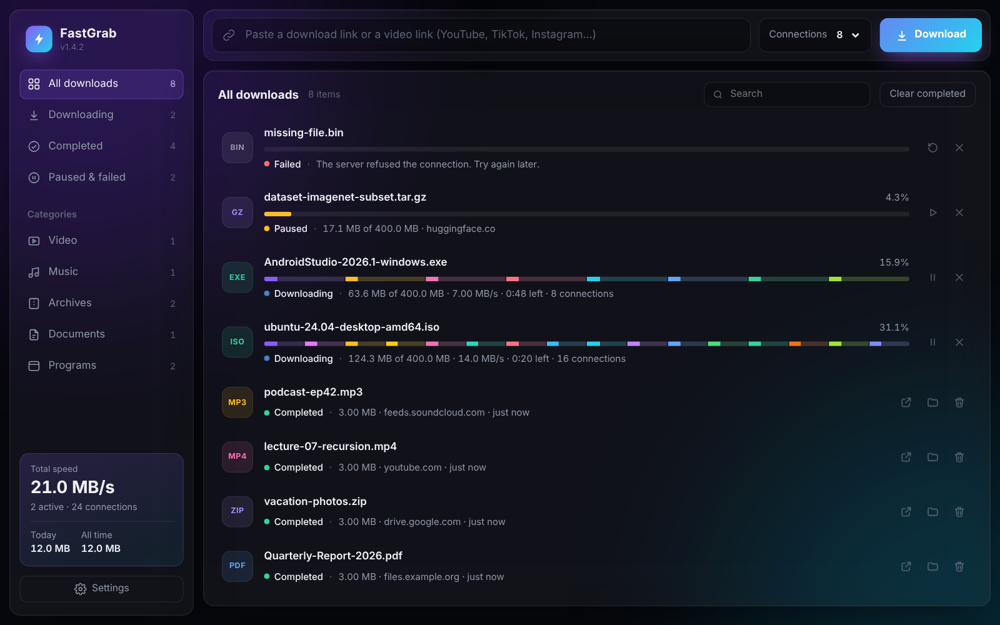

# fastgrab ⚡

[](https://github.com/mohamad-mhajna/fastgrab/actions/workflows/tests.yml)


**Up to 15× faster downloads.** A multi-connection download manager with a desktop app, a browser extension and a command-line tool, built with **only the Python standard library**. It also downloads videos from YouTube, TikTok, Instagram and 1,000+ other sites.



## Download

Get **[FastGrab.exe](https://github.com/mohamad-mhajna/fastgrab/releases/latest)** for Windows: a single file, nothing to install, video support included. Or run from source on any OS: `python fastgrab_app.py`.

## Benchmark


The server limits each connection to 5 MB/s, as many real servers do. Each result is the average of 2 runs, and every file was verified by SHA-256. With no limit, the engine reaches 380 MB/s, so your internet plan is the real limit: 100 Mbit/s tops out around 12 MB/s.

## Features

- **Fast:** splits each file across up to 32 connections, and idle connections take over half of the slowest one's work, so there's no slow tail at the end
- **Never loses progress:** pause anytime; even a crash or power cut resumes where it stopped
- **Video mode:** YouTube, TikTok, Instagram, X, Facebook, Reddit and more, with a quality picker (4K to audio only)
- **Browser extension** (Chrome/Edge): downloads you start in the browser go to FastGrab, cookies included
- **Runs in the tray:** close the window and downloads keep going at the same speed
- **Scheduler:** download overnight, then sleep or shut down the PC
- **Auto-update** for both the app and video support, verified by SHA-256
- **English, العربية and עברית**, with a full right-to-left layout
- **See every connection:** each download's progress bar shows every connection filling its own part of the file

> Only download videos you have the right to save.

## How it works

1. **One request does two jobs.** The first request asks for the file from byte 0 onward. The answer tells fastgrab the size and whether the server supports ranges, and then it keeps downloading as connection #1.
2. **Work stealing.** Each connection owns a byte range. When one finishes, it takes the biggest remaining range and splits it in half:

   ```mermaid
   flowchart LR
       A["conn 1: [0 ─────────────── 30 MB)"] -->|conn 2 steals| B["conn 1: [0 ── 15 MB)   conn 2: [15 ── 30 MB)"]
       B -->|conn 3 steals the bigger half| C["conn 1: [0 ─ 15)   conn 2: [15 ─ 22.5)   conn 3: [22.5 ─ 30)"]
   ```
3. **No merge step.** Every connection writes straight to its final place in one pre-allocated file.
4. **Crash-safe resume.** Every second it saves progress in a fixed order: *snapshot → fsync → atomic save*. The saved state can never claim bytes that aren't on disk, and if the file changed on the server (ETag, Last-Modified or size), it starts over instead of corrupting it.

<details>
<summary><b>More details</b>: app architecture, security, thread safety</summary>

- **App:** the window is a single HTML page shown by Edge in app mode (no tabs or address bar). It talks to `fastgrab_app.py`, a local API on `127.0.0.1` that runs the downloads.
- **Security:** the API needs a random 192-bit token generated at each start and checks the `Host` header, so websites you visit can't control your downloads. The browser extension uses its own pairing key.
- **Thread safety:** each range tracks two cursors: `claim` (reserved by its owner, used for splitting) and `pos` (actually written, used for saving). A split can't land on bytes that are about to be written, and saved progress is never ahead of the disk.
- **Fallbacks:** single connection when a server doesn't support ranges, plus automatic retries with backoff when connections drop.

</details>

## Command line

```bash
python fastgrab.py URL                          # 8 connections, current folder
python fastgrab.py URL -c 16 -o ~/Downloads     # 16 connections, custom folder
python fastgrab.py "https://youtu.be/..." -q 1080
```

Press **Ctrl+C** to pause; run the same command again to resume. On Windows, `install.ps1` adds `fastgrab` to your PATH (no admin rights), or use `fastgrab-cli.exe` from the [Releases page](https://github.com/mohamad-mhajna/fastgrab/releases/latest).

## Tests

```bash
python -m unittest discover -s tests -v
```

100+ checks run on Windows, macOS and Linux through GitHub Actions. A local test server can throttle, cut or refuse connections, and every download is verified by SHA-256. Releases are only published after the built `FastGrab.exe` itself passes the tests.

<details>
<summary><b>What the tests cover</b></summary>

| Test | What it proves |
|---|---|
| `test_fastgrab` (5) | 8 connections give an identical file over 3× faster; resume after `kill -9`; servers without ranges; randomly dropped connections; 2000 random splits always tile the file exactly |
| `test_app` (8) | the app's API: live progress, pause/resume, same-name files, cancel removes only its own files, security checks; video info, quality choice and pause/resume |
| `test_features` (11) | scheduler, when-done countdown, settings and languages, extension pairing key and cookies |
| `test_tray` (13) | closing the window keeps downloading, one window at a time, Pause all / Resume all; on Windows the real tray icon, notifications and keep-awake |
| `test_update` (5) | verified yt-dlp updates with fallback; a full self-update and restart; no update offered before its files are uploaded |
| `ui_e2e.py` (41) | the window in a real Chrome: filters and search, per-connection progress in each row, plain-language errors, the details panel, stats, the empty screen, and the update popup end to end (Later, Update now, Arabic layout) |
| `extension_e2e.py` (13) | the extension in a real Chrome: catching downloads, cookies, right-click menu, fallback when FastGrab is closed |

</details>

## Roadmap

- [ ] Speed limiter
- [ ] Optional checksum verification (`--sha256`)

## License

[MIT](LICENSE) © 2026 Mohamad Mahajna
