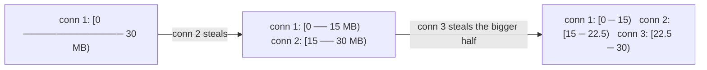

# fastgrab ⚡

[](https://github.com/mohamadar8162-design/fastgrab/actions/workflows/tests.yml)


A multi-connection download manager in a single Python file, built with **only the standard library**.

It speeds up downloads the same way IDM does: it splits a file into byte ranges, downloads them over several connections in parallel, and keeps every connection busy until the last byte by **stealing work** from the slowest one. If the download is interrupted (Ctrl+C, a dropped connection, even a crash or power cut), it resumes where it left off.

```
$ python fastgrab.py https://example.com/big.iso -c 8
File : big.iso
Size : 30.0 MB
Resumable: yes
[##############################] 100.0%  30.0 MB/30.0 MB  14.7 MB/s  ETA 0:00  conns 8
Done -> ./big.iso
```

## Benchmark

30 MB file from a test server that limits each connection to 2 MB/s (this kind of per-connection limit is common on real servers):

| Connections | Time | Speed |
|---|---|---|
| 1 (like a normal browser download) | 15.5 s | 2.0 MB/s |
| 8 (fastgrab default) | **2.3 s** | **~14 MB/s** |

That's **6.7× faster**, and the SHA-256 of both files matches the original.

## Features

- **Parallel segmented downloads** over HTTP `Range` requests (default 8 connections)
- **Dynamic work stealing**: idle connections split the largest remaining segment, so there's no slow tail at the end
- **Crash-safe resume**: progress is checkpointed every second and survives `kill -9` and power loss
- **Change detection**: if the file changed on the server (ETag / Last-Modified / size), it restarts instead of producing a corrupted file
- **Automatic retries** with exponential backoff when connections drop
- **Fallback** to a single connection when the server doesn't support ranges
- **No merge step**: every connection writes straight to its final offset in one file
- Custom headers (`Cookie`, `Referer`, …) for downloads that need you to be logged in
- Zero dependencies, so it runs anywhere Python 3.10+ runs (Windows, macOS, Linux)

## Install (Windows)

```powershell
powershell -ExecutionPolicy Bypass -File install.ps1
```

This copies fastgrab to `%LOCALAPPDATA%\Programs\fastgrab` and adds that folder to your **user** PATH. Your other PATH entries aren't touched, and a backup is saved first. No admin rights are needed. Then open a new terminal and run `fastgrab URL` from anywhere. To remove it, run `uninstall.ps1`, which removes only what the installer added.

On macOS/Linux, just run `python3 fastgrab.py URL`.

## Usage

```bash
python fastgrab.py URL                          # 8 connections, save to current folder
python fastgrab.py URL -c 16 -o ~/Downloads     # 16 connections, custom folder
python fastgrab.py URL -H "Cookie: session=abc" -H "Referer: https://site.com"
```

Press **Ctrl+C** to pause. Run the same command again to resume.

## How it works

### 1. Probe without a wasted request

The first request is a normal `GET` with `Range: bytes=0-`. If the server answers `206 Partial Content` with a `Content-Range` header, ranges are supported and we learn the total size. That same response then keeps streaming as connection #1, so no separate `HEAD` request is needed. A `200` means no range support, so fastgrab falls back to one connection.

### 2. Work stealing

Each segment is a byte range `[pos, end)`. When a connection is idle, it takes the segment with the most bytes left and splits it at the midpoint (4 KiB aligned, never below 512 KiB):



The victim's `end` simply shrinks. It notices on its next read, writes up to the new end, and closes its connection. The same thing happens whenever a connection finishes early, so fast connections keep helping slow ones until the very end.

To make stealing safe across threads, each segment tracks two cursors:
- `claim` is how far the owner has *reserved* (used for splitting, so a split can never land on bytes that are about to be written)
- `pos` is how far is actually *written* (used for saving state, so saved progress is never ahead of the disk)

### 3. Positioned writes

The output file `name.fgpart` is pre-allocated to its full size, and every connection writes its bytes directly at their offset (`seek` + `write`). When everything is done, the file is fsynced and atomically renamed. There are no temporary part files and no slow merge step.

### 4. Crash-safe resume

Every second, fastgrab saves the remaining segments to `name.fgpart.json`, in this order:

1. **snapshot** the segment table
2. **fsync** the data file
3. **atomically replace** the JSON (write to `.tmp`, fsync, `os.replace`)

Because the snapshot comes before the fsync, the saved state can never claim bytes that aren't really on disk. On restart, fastgrab probes the URL again, compares size + ETag + Last-Modified with the saved state, and only downloads what's missing.

## Tests

```bash
python -m unittest discover -s tests -v
```

The suite starts a local HTTP server (`tests/server.py`) that can throttle each connection, ignore `Range`, or randomly cut connections. Each test then checks the SHA-256 of the downloaded file:

| Test | What it proves |
|---|---|
| `test_multi_connection_matches_and_is_faster` | 8 connections give an identical file and finish over 3× faster than 1 |
| `test_resume_after_hard_crash` | the process is `SIGKILL`ed mid-download and resumes to an identical file |
| `test_server_without_range_support` | single-connection fallback works |
| `test_survives_dropped_connections` | a server that randomly drops connections still yields a correct file |
| `test_splits_never_overlap_or_leave_gaps` | 2000 random claim/steal steps always tile the file exactly |

Tests run on Linux, Windows and macOS through GitHub Actions.

## Roadmap

- [ ] Browser extension (Chrome MV3 + native messaging) to catch downloads automatically
- [ ] Download queue and speed limiter (token bucket)
- [ ] Optional checksum verification (`--sha256`)
- [ ] GUI (Tkinter or PyQt)

## Inspiration

The engine design (probe-as-first-stream, midpoint work stealing, `snapshot → fsync → persist` checkpoints) is inspired by the architecture of [Prism Download Manager](https://github.com/FortoGraphy/prism-download-manager), a full-featured download manager written in Rust. fastgrab is an independent, from-scratch Python implementation of those ideas.

## License

[MIT](LICENSE) © 2026 Mohamad Mahajna
